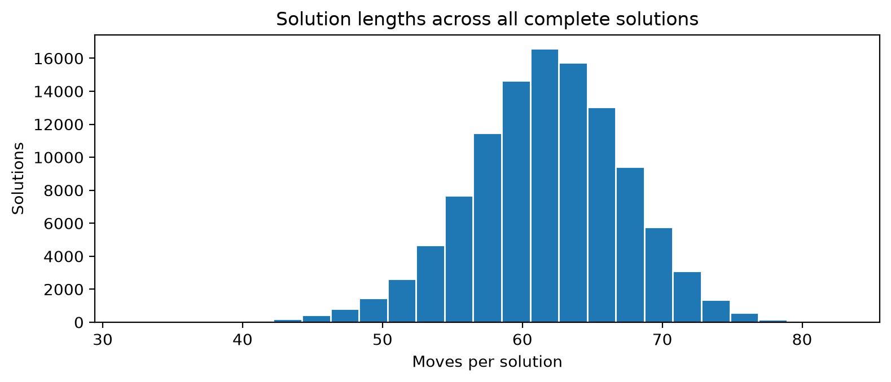
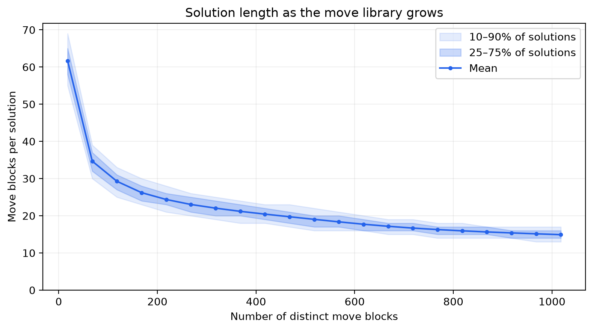
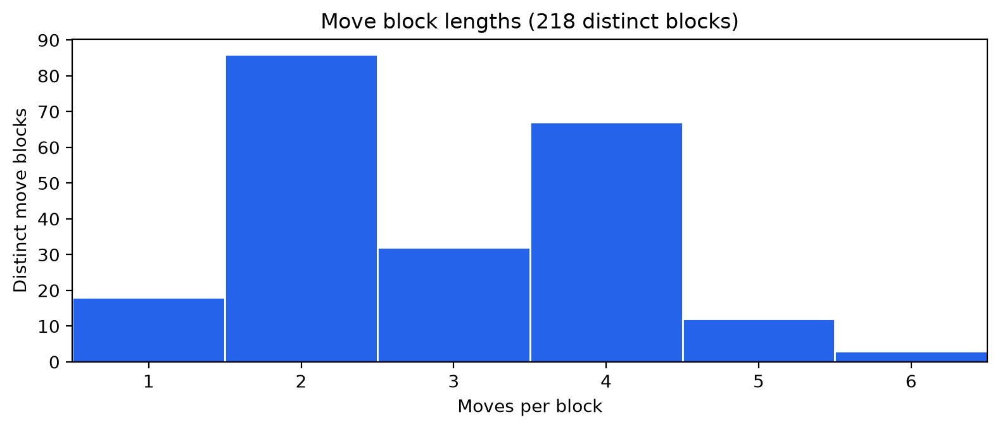
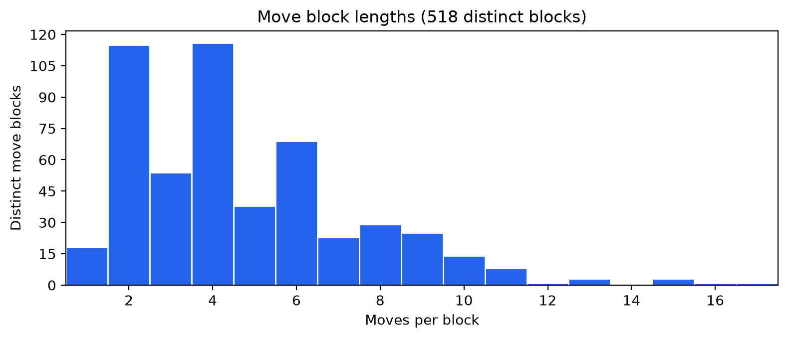
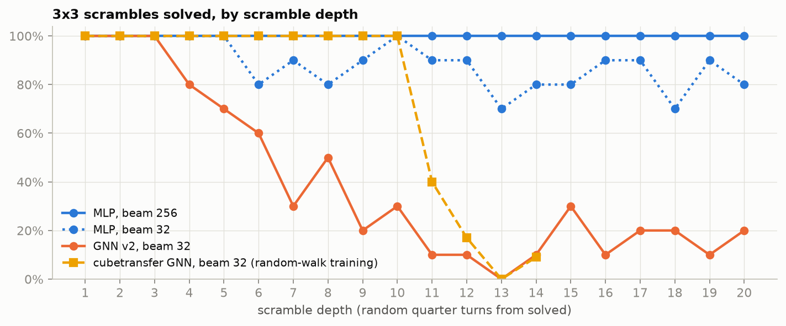
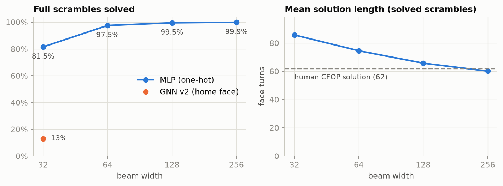

# arbCube

Graph neural networks that learn to solve Rubik's cubes of any size, starting from
human solutions of the 3x3.

## The question

Can one network learn to solve a cube it was not trained on, a 4x4x4, a 5x5x5, even a
4D 3x3x3x3, from data that only covers the 3x3?

A cube is naturally a graph. Its stickers or pieces are nodes, and which ones touch,
belong to the same piece, or share a color are edges. That structure looks the same on
every cube size, so a graph neural network over it has no fixed input size: the same
weights run on any cube. A standard network over a flat sticker vector, like the MLP
baseline here, is tied to one puzzle's input and move list and cannot be reused.

We attack the question from two directions on one shared dataset, the Kaggle CFOP
solutions (110,000 human 3x3 solves):

| Direction | Idea | Folder |
|---|---|---|
| **Direct transfer** | Train a puzzle-agnostic GNN heuristic on the 3x3x3, then fine-tune it on bigger puzzles | `cubetransfer.zip` |
| **Reduction** | Reduce any NxN cube to a 3x3 (centers, edge pairing, parity), then solve the 3x3 with a policy that imitates human CFOP solves | `nxn_reduction/` |
| **Structure in human solves** | Learn reusable move blocks from the CFOP solves with BPE: a candidate action space for both | `arbcube/`, `notebooks/` |

### How the pieces fit

```
Kaggle CFOP solves ──> loaders, move-block analysis (arbcube/, notebooks/)
        │
        ├──> imitation policy on the 3x3 ──> beam search ──> solves 3x3 scrambles
        │      (nxn_reduction/)                               ▲
        │                                                    │ reduce NxN -> 3x3
        │                                                    │ (nxn_reduction/cube/)
        └──> size-free GNN heuristic, 3x3x3 -> 4x4x4, 3x3x3x3 (cubetransfer)
```

### The graphs

- **cubetransfer:** a piece-slot graph (pieces linked to adjacent and home slots), a
  relation-typed GNN with a value head and a policy head that works for any move set,
  and a sticker-facet graph as an ablation.
- **nxn_reduction:** a sticker graph. Nodes are the 6N² stickers with size-free features
  (face, position within the face, piece size, and the face its color belongs to).
  Typed edges link stickers that touch, share a piece, or share a color with a center.
  One GINE layer is shared across 6 message-passing steps, and the policy head scores
  each move from the stickers that move turns. Colors are never features, so the model
  cannot tell which color is which, only which stickers match.

## Results so far

### 1. Human solves have reusable structure



The human CFOP solutions are about 62 moves long on average, almost all between 45 and
75.



BPE repeatedly merges the most frequent adjacent pair of move blocks. As the library
grows from the 18 single moves, solutions shrink from 61.6 blocks on average to about 24
blocks with 218 distinct blocks, about 19 with 518 and about 15 with roughly 1,000,
about a 4x compression. The steepest drop comes from the first 50 merges. These numbers
measure compression of the training corpus, not held-out results.

<p>


</p>

Most learned blocks are 2 or 4 moves long, the length of common CFOP move pairs and
triggers. With 518 blocks, a tail of 8- to 17-move blocks appears, the length of whole
last-layer algorithms.

### 2. A GNN trained on the 3x3x3 transfers to bigger puzzles

The cubetransfer GNN is trained on random scramble walks and searched with a width-32
beam.

- **It needs less data on new puzzles.** On the 4x4x4, fine-tuning from the 3x3x3
  reaches the 90% solve bar after a median of 150k training states, against 400k from
  scratch (8 seeds). On the 3x3x3x3 it needs 100k, against 280k on average (5 seeds).
- **It works zero-shot.** With no fine-tuning, the 3x3x3 weights solve 48% of the
  4x4x4 suite and 87% of the 3x3x3x3 suite. The 4D result varies between checkpoints:
  38% and 100% on the same scrambles.
- **The head start is about speed.** By about 1M 4x4x4 states, fine-tuned and scratch
  networks are level. After 3M states both solve about 70% of a depth 1-16 suite.
- **Random walks limit depth.** On the 3x3x3 the piece-slot GNN solves everything up to
  10 quarter turns and little beyond 12; a 16x wider beam buys about one move.

### 3. Imitating human solves removes the depth limit



Learning from full human solutions instead of random walks changes what the search can
reach. An imitation policy with a width-256 beam solves every random-walk scramble from
1 to 20 quarter turns deep, and 99.9% of 1,000 held-out full scrambles. Its solutions
average 60 face turns, against 62 for the human solves (0.2 s per scramble on a laptop
CPU). The policy here is still the one-hot baseline; the GNN version is the main open
problem (below).



### 4. Where the GNN stands

The two directions give complementary pictures of the GNN against a flat MLP baseline:

| Setting | GNN | Flat MLP baseline |
|---|---|---|
| 4x4x4 depth 1-16 solved after 3M random-walk states (cubetransfer; matched in states, not compute) | about 70% | 49% |
| Runs unchanged on a different puzzle | yes | no |
| 3x3 next-move accuracy, imitating CFOP (nxn_reduction) | 63.2% | 79.8% |
| 3x3 full scrambles solved, beam 32 (nxn_reduction) | 13% | 81.5% |

On the 4x4x4 random-walk task the GNN is ahead. On 3x3 imitation it is still behind, but
improving: one feature (each sticker's home face) raised it from 54.7% to 63.2%, and it
was still improving when training stopped. Its remaining gap is on the last layer
(OLL: 61% against 90%), where the right move depends on exact patterns across a whole
face. Closing that gap is the first goal for the final.

### 5. Reduction for any NxN

Projecting a reduced NxN cube to a 3x3, lifting 3x3 moves back to NxN, and detecting and
fixing both even-cube parities (OLL and PLL) are implemented and tested (280 tests).
Solving the centers and pairing the edges, the remaining reduction steps, are next.

## Next steps

1. **Close the GNN gap on 3x3 imitation.** Add a global readout to the policy head so it
   sees whole-face patterns, train longer on more rows (it was still improving), and use
   the GNN's value head (moves remaining) to rank the beam.
2. **Finish the NxN solver.** Center solving and edge pairing, then solve 4x4x4 and
   5x5x5 scrambles end to end through reduction.
3. **Move blocks as actions.** Search over the learned BPE move blocks instead of
   single moves: about 4x fewer decisions per solve, which could also push past the
   random-walk depth limit.
4. **Combine the two directions.** Pretrain the size-free GNN on CFOP imitation, then
   fine-tune it on bigger cubes, as cubetransfer does from random walks.
5. **One protocol.** Write a converter between the two cube conventions and score every
   model on the same suites: random-walk depth (quarter turns, with and without
   cubetransfer's length cap) and full scrambles.

## Team

| Member | Work |
|---|---|
| pmn (`pmnoe`) | Project setup (uv), reproducible dataset download and loaders, BPE move-block analysis and notebook |
| ben-mcaulay | cubetransfer: n^d cube engine, puzzle-agnostic GNN, transfer experiments, results viewer |
| props-fd | nxn_reduction: NxN simulator, reduction and parity, CFOP parser and dataset, sticker GNN and baseline, beam search |

<!-- AI use: fill in to match the course policy before submitting. -->

## Notes on the folders

- `nxn_reduction/` and cubetransfer use different cube conventions (sticker order,
  color labels, permutation direction, and face turns against quarter turns), so their
  states can't be exchanged without a converter. `nxn_reduction/README.md` lists the
  differences.
- The dataset section below lists the face order and the color-to-integer encoding as
  unverified. `nxn_reduction/data/parse_cfop.py` has since checked both by replaying
  every solve to solved.
- The BPE numbers are read off the notebook's plots; run `notebooks/01_cfop_basics.py`
  for exact values. The cubetransfer numbers come from the results inside
  `cubetransfer.zip`. Details on nxn_reduction: `nxn_reduction/results/RESULTS.md`.

## Setup

Install [uv](https://docs.astral.sh/uv/getting-started/installation/), then run
the following from the repository root:

```sh
uv sync --locked
```

This creates a local `.venv` using Python 3.12 (specified in `.python-version`)
and installs the dependencies from `uv.lock`. uv downloads Python if needed.

Run Python or a project script inside the managed environment:

```sh
uv run python
# Once you have a script: uv run python path/to/script.py
```

Environment activation is optional; `uv run` uses `.venv` automatically.

## CFOP dataset

Download the [Rubik's cube CFOP solutions dataset](https://www.kaggle.com/datasets/antbob/rubiks-cube-cfop-solutions)
into `data/raw/cfop-v1/`:

```sh
uv run python -m arbcube.data
```

The downloader uses KaggleHub and pins dataset version 1 (the latest when added)
so collaborators analyze the same data. Repeating the command reuses the local
download. Raw data and generated reports are ignored by Git; share the download
command instead of committing the dataset. The download is about 137 MiB and
extracts to about 756 MiB.

For Python scripts or an interactive session from the repo root:

```python
from arbcube.data import load_solutions, load_transitions

solutions = load_solutions()
transitions = load_transitions(limit_per_shard=1_000)
```

`load_solutions()` reads all complete solutions; pass `limit_per_shard=1_000`
for a smaller starting sample. `load_transitions()` reads a bounded prefix of
each sequence shard, rather than loading the much larger sequence files whole.
These prefixes are convenience samples, not random samples.

The `training.N` files alternate a 54-color state with a complete solution;
`training.seq.N` alternates a 54-integer state with one action or the terminal
marker `#`. Blank separator lines are skipped. Shard names and record indices
are preserved; the role of `training.99` is unverified, so check the intended
train/test split before training. Face ordering and the relationship between
the color and integer encodings also need verification before building graphs.

If Kaggle requests authentication, follow the
[KaggleHub authentication instructions](https://github.com/Kaggle/kagglehub#authenticate).

## Basic exploration with marimo

From the repo root, run:

```sh
uv sync --locked
uv run python -m arbcube.data
uv run marimo edit notebooks/01_cfop_basics.py
```

The notebook loads all 110,000 complete solutions and shows solution lengths,
move counts, and BPE compression. Set `rows_per_shard` to
an integer in the loading cell if you want to limit the rows read per shard.

The BPE section learns move blocks by repeatedly merging frequent adjacent
blocks, starting from single moves. A move block is a single move or a learned
sequence of moves. Adjust the merge budget to explore larger move libraries.
Merges never cross solution boundaries.

The solution-length curve plots mean move blocks per solution against the
number of distinct move blocks on a linear x axis, with 10–90% and 25–75%
quantile bands. It starts at the unmerged baseline and follows the selected
merge budget. These lengths measure compression on the loaded training corpus,
not held-out performance. A histogram below shows moves per block for the
selected move library, counting each distinct block once, including single moves.

## Managing dependencies

Use uv to update the shared dependency files:

```sh
uv add <package>
uv add --dev <package>
uv remove <package>
```

To intentionally upgrade all dependencies allowed by `pyproject.toml`:

```sh
uv lock --upgrade
uv sync --locked
```

Commit `pyproject.toml` and `uv.lock` together whenever dependencies change.
Commit `.python-version` when changing the team's Python version. After pulling
changes, run `uv sync --locked` to update your environment. `.venv` is ignored
by Git. Let uv generate `uv.lock` rather than editing it by hand.
