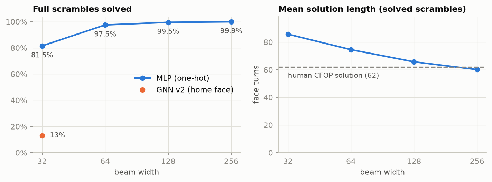
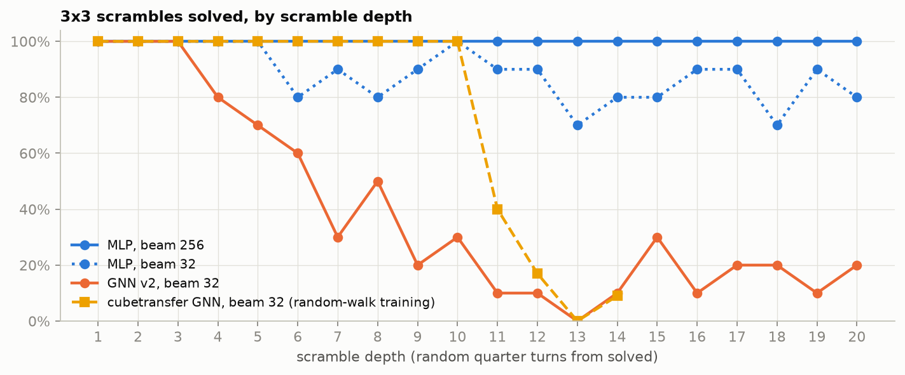
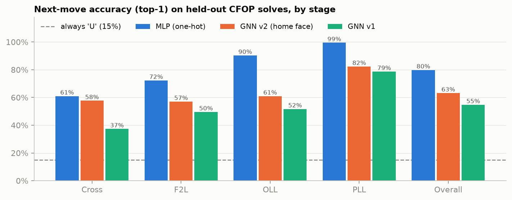
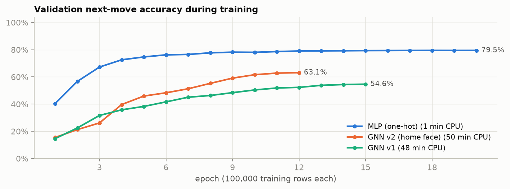

# Results

All numbers come from `train_report.json` and `search_report.json` in this folder;
`plot.py` redraws every figure from them. "Held out" means the CFOP test split (5% of
solves, split by solve, seed 224). Every solve counted below was replayed in the
simulator first.

## 1. Solving full 3x3 scrambles

The MLP policy with beam search solves 81.5% of 200 held-out full scrambles at beam
width 32, 97.5% at 64, 99.5% at 128 and **99.9% of 1,000 at 256** (0.2 s per scramble
on a laptop CPU). A wider beam also shortens the solutions: from 86 face turns at width
32 to 60 at width 256, slightly shorter than the human CFOP solutions of the same
scrambles (62). GNN v2 at width 32 solves only 13%.

## 2. Solve rate by scramble depth

Scrambles are random quarter-turn walks from solved, 10 per depth (the cubetransfer
suite design). At width 256 the MLP solves every scramble at every depth from 1 to 20.
The cubetransfer GNN, trained on random walks, stops solving past about 10 quarter
turns. Its curve is copied from `cubetransfer.zip` (`web/diagnostics.json`, piece-slot
graph, beam 32, 1M training states), and its "solved" also requires a short solution
(at most K + 4 quarter turns), which ours does not: the CFOP policy solves short
scrambles the long way, so only 50% (width 32) to 61% (width 256) of depth 1..10
scrambles are solved within 14 quarter turns. GNN v2 falls off after depth 3.

## 3. Next-move accuracy by CFOP stage

Top-1 accuracy at predicting the human's next move, on 20,000 held-out rows. The MLP
reaches 79.8%; the GNNs reach 63.2% (v2) and 54.7% (v1). The home-face feature in v2
(which face's center matches each sticker's color) closed most of the gap on the cross
(37% to 58%, against 61% for the MLP), but the GNNs still trail far behind on the last
layer (OLL 61% against 90%), where the right move depends on exact sticker patterns.

## 4. Training

All three models train on the same 100,000 rows on CPU. The MLP plateaus within about
8 epochs and 1 minute. Both GNNs take about 50 minutes and are still rising when their
learning-rate schedules end; their final training loss (v2: 1.05, against 0.27 for the
MLP) says they underfit rather than overfit.

## Setup

| | |
|---|---|
| Data | Kaggle `antbob/rubiks-cube-cfop-solutions` v1, 11 shards x 10,000 solves, normalized to the 18 face turns |
| Training rows | 100,000 random (state, next move) rows of the train split, from 63,078 solves |
| MLP | one-hot stickers (54 x 6) -> 512 -> 512 -> 18, 438k parameters, 20 epochs |
| GNN v1 / v2 | one GINE layer shared over 6 steps; hidden 64 / 128; v2 adds the home-face feature and keeps only same-color edges to centers; 15 / 12 epochs |
| Search | beam search ranked by cumulative policy log-probability; no move turns the previous move's face; revisited states dropped; up to 150 moves |
